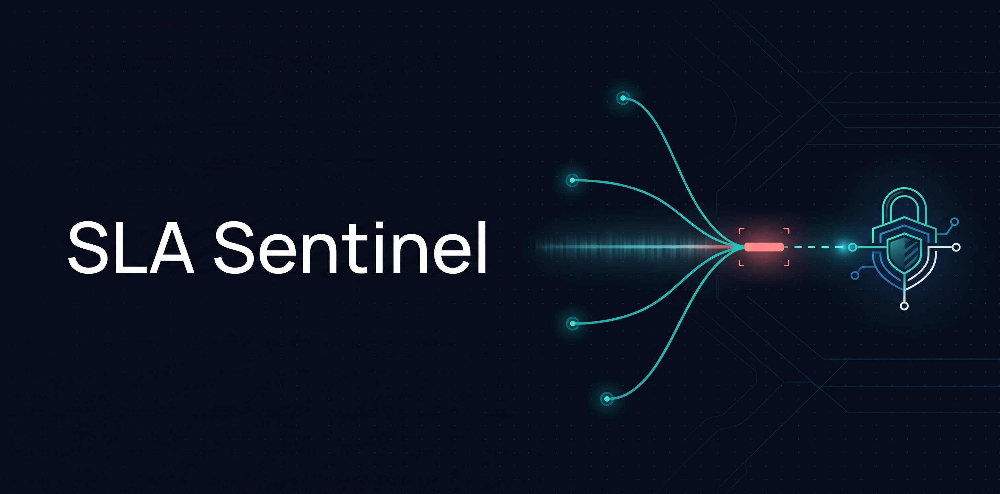
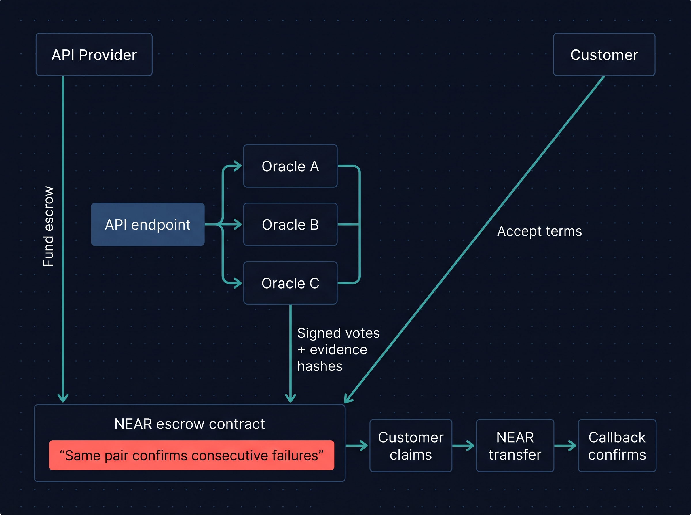
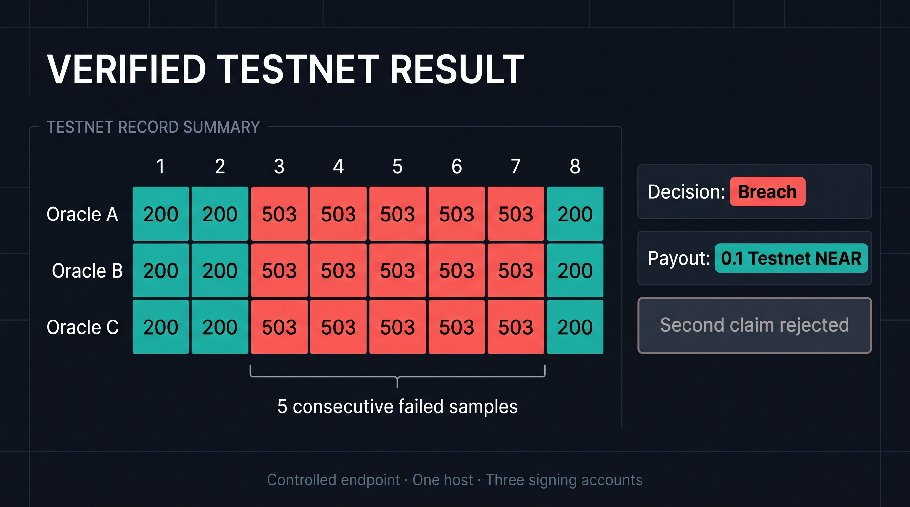

# SLA Sentinel

SLA Sentinel lets API providers pre-fund outage compensation on NEAR. The provider deposits a fixed amount for an observation window, and the customer accepts the terms before monitoring starts. The same two authorized oracle accounts must corroborate a consecutive run of failed samples before the customer can claim. A working deployment is available on NEAR Testnet.

## Explore the demo evidence

Open `docs/index.html` from a local checkout in your browser.
Compare oracle pairs in the Testnet payout and Sandbox refund, then open the
payment receipt details or the full evidence JSON. The viewer uses the archived
observations and needs no wallet or dependencies to open.

If the archived proofs change, regenerate the viewer data with Node 22.22.2 or
later by running `node docs/evidence-viewer/generate.mjs` from the repository root.



## How it works



Each oracle probes the endpoint and submits its own signed vote and evidence hash.

See the [architecture](docs/architecture.md) for agreement terms, evidence, and payment safety.

## Verified Testnet demonstration

On November 11, 2026, three oracle accounts submitted signed observations of a
controlled HTTP outage. Agreement `0` recorded five consecutive failed slots
and paid the customer **0.1 Testnet NEAR**. A repeated claim was rejected by the
demo runner. The payment and callback receipts were verified at `FINAL`, and
the three evidence bundles were matched to the final on-chain votes.



- [Payment transaction](https://testnet.nearblocks.io/txns/CtqZaUPokXKGr4XCpSfwCngN4Y91Gd3PRvPXCcVfXoLN)
- [Testnet contract](https://testnet.nearblocks.io/address/404f32f6-escrow.sla-sentinel-1794396951.testnet)
- [Evidence, agreement and receipt JSON](examples/testnet/payment-proof.json)

The controlled endpoint and all three observers ran on one host. The Testnet
contract account had one full-access key at verification time.

Recheck the payment without credentials from `packages/operator` after `npm ci`:

```sh
npm run verify:payment -- --contract 404f32f6-escrow.sla-sentinel-1794396951.testnet \
  --customer 404f32f6-customer.sla-sentinel-1794396951.testnet \
  --sla-id 0 --tx CtqZaUPokXKGr4XCpSfwCngN4Y91Gd3PRvPXCcVfXoLN
```

## Inconclusive evidence demonstration

The same contract was tested in NEAR Sandbox with four scripted sample slots
and a threshold of four consecutive failures. A question mark denotes a missing
sample.

| Oracle | Slot 1 | Slot 2 | Slot 3 | Slot 4 |
| --- | --- | --- | --- | --- |
| A | Down | Down | ? | ? |
| B | Down | Down | Down | Down |
| C | ? | ? | Down | Down |

Two oracles reported `Down` in every slot. The longest run confirmed by a
single pair was two, while the longest possible run was four. The contract
returned `inconclusive`, rejected the customer's claim, and refunded the
**0.1 Sandbox NEAR** principal to the provider. A second refund claim was
rejected. See the [Sandbox evidence and receipts](examples/sandbox/inconclusive-proof.json)
and the [reproduction command](docs/operations.md#check-payment-in-a-local-sandbox).

## Repository layout

| Path | Purpose |
| --- | --- |
| `contracts/sla-escrow/` | Rust agreement, escrow and payment logic, with contract tests. |
| `packages/operator/src/` | CLI commands, monitoring, oracle signing, settlement verification and demo support. |
| `packages/operator/test/` | TypeScript tests for measurements, signing and receipt verification. |
| `examples/testnet/` | Evidence and receipts from the recorded Testnet payment. |
| `examples/sandbox/` | Scripted observations and receipts from the inconclusive case. |
| `docs/` | Architecture, operator instructions and the evidence format. |

## Escrow checks

Install Rust 1.95.0 with the `wasm32-unknown-unknown` target. The contract is under `contracts/sla-escrow`.

```sh
cd contracts/sla-escrow
cargo test --locked --lib
RUSTFLAGS='--cfg near' cargo build --locked --release --target wasm32-unknown-unknown
SLA_ESCROW_WASM=target/wasm32-unknown-unknown/release/sla_escrow.wasm \
  cargo test --locked --features sandbox-tests --test sandbox
```

The sandbox suite uses isolated accounts and virtual funds. The signed Testnet demonstration requires separate development accounts and a published deployment record.

If the contract Wasm is already built, the [Node Sandbox payment check](docs/operations.md#check-payment-in-a-local-sandbox) runs the payment and duplicate-claim assertions without compiling Rust test dependencies.

## Oracle and receipt checks

Install Node 22.22.2 or later, then run:

```sh
cd packages/operator
npm ci
npm test
```

See the [Testnet demo commands](docs/operations.md) for running the
controlled outage, submitting oracle votes, and verifying the claim receipts.
The [single-command Testnet demo](docs/operations.md#run-the-testnet-payment-demo)
produces an explorer link and a JSON proof with a funded Testnet sponsor.

## License

[MIT](LICENSE)
